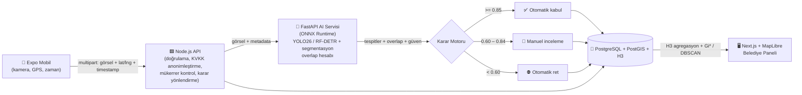
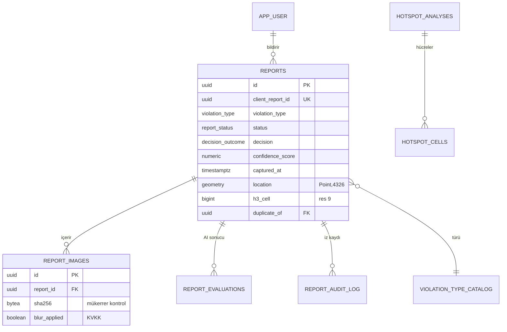

# 🚸 Yaya Alanı İhlal Tespiti ve Şehir Analiz Platformu

**TÜBİTAK 2209-A Üniversite Öğrencileri Araştırma Projeleri Destekleme Programı**

Yapay zekâ destekli, KVKK uyumlu ve mekânsal analiz odaklı bir yaya yolu ihlal tespit / karar destek platformu. Vatandaşların sahada çektikleri fotoğraflar, yapay zekâ servisinde nesne tespiti ve segmentasyon ile analiz edilir; güven skoruna göre otomatik kabul, manuel inceleme veya otomatik ret kararı üretilir. Biriken veriler PostGIS + H3 ızgarası üzerinde sıcak nokta (hotspot) analizine dönüşür ve belediye yönetim paneline sunulur.

> **Durum:** Faz 0 — Monorepo iskeleti, altyapı ve veritabanı şeması tamamlandı.

---

## İçindekiler

- [Problem ve Amaç](#problem-ve-amaç)
- [Sistem Mimarisi](#sistem-mimarisi)
- [Bileşenler](#bileşenler)
- [Karar Mekanizması](#karar-mekanizması)
- [Depo Yapısı](#depo-yapısı)
- [Hızlı Başlangıç](#hızlı-başlangıç)
- [Ortam Değişkenleri](#ortam-değişkenleri)
- [Veri Modeli](#veri-modeli)
- [KVKK ve Gizlilik](#kvkk-ve-gizlilik)
- [Yol Haritası](#yol-haritası)
- [Katkı ve Commit Kuralları](#katkı-ve-commit-kuralları)

---

## Problem ve Amaç

Kaldırımların araç, tabela, inşaat malzemesi veya geçici engellerle işgali; yaya geçitlerinin kapatılması ve yüzey bozulmaları kent içi erişilebilirliği doğrudan düşürmektedir. Belediyelerde bu ihlallerin tespiti ağırlıklı olarak denetim ekiplerinin saha taramasına bağlıdır; bu da ölçeklenemeyen, geciken ve nesnel olmayan bir süreçtir.

Bu proje:

1. **Vatandaş katılımı** ile sahada fotoğraf + GPS + zaman damgası toplar,
2. Görüntüyü **nesne tespiti (YOLO26 / RF-DETR)** ve **semantik segmentasyon** ile analiz ederek ihlal-geometri örtüşmesini (overlap/IoU) ölçer,
3. **Güven skoru eşikleri** ile üç aşamalı bir karar hattı işletir (otomatik kabul / manuel inceleme / otomatik ret),
4. Sonuçları **PostGIS + H3** üzerinde indeksleyip **DBSCAN / Getis-Ord Gi*** ile sıcak nokta analizine dönüştürür,
5. Belediyeye **MapLibre tabanlı yönetim paneli** üzerinden önceliklendirilmiş müdahale listesi sunar.

---

## Sistem Mimarisi



Detaylı tasarım kararları için [`docs/ARCHITECTURE.md`](docs/ARCHITECTURE.md), faz planı için [`docs/ROADMAP.md`](docs/ROADMAP.md) dosyalarına bakın.

---

## Bileşenler

| Katman | Teknoloji | Sorumluluk |
| --- | --- | --- |
| `apps/mobile` | React Native + Expo (TypeScript) | Yalnızca canlı kamera çekimi, GPS + zaman damgası doğrulaması, JSON/multipart paketleme, çevrimdışı kuyruk |
| `services/api` | Node.js + Fastify + TypeScript | REST API, şema doğrulama, KVKK anonimleştirme (yüz/plaka), mükerrer kayıt kontrolü, karar yönlendirme, Supabase/PostgreSQL erişimi |
| `services/ai-service` | Python + FastAPI + ONNX Runtime | YOLO26 & RF-DETR nesne tespiti, kaldırım/yaya geçidi segmentasyonu, IoU/overlap ve güven skoru üretimi |
| `apps/web` | Next.js + React + MapLibre GL | Belediye yönetim paneli, inceleme kuyruğu, H3 ısı haritası, Gi*/DBSCAN katmanları |
| `infra` | PostgreSQL 16 + PostGIS + h3-pg, Docker | Şema, init script'leri, konteyner imajları, yedekleme ve migrasyon stratejisi |
| `ml-pipeline` | Python (Ultralytics / ONNX export) | Veri seti hazırlama, etiketleme formatları, eğitim, doğrulama ve ONNX'e export |

---

## Karar Mekanizması

Karar eşikleri veritabanında (`system_setting.decision.thresholds`) tutulur; API ve AI servisi aynı değerleri `.env` üzerinden okur. Eşikler tek yerden değiştirilebilir.

| Güven skoru | Karar (`decision_outcome`) | Durum (`report_status`) | Akış |
| --- | --- | --- | --- |
| `score >= 0.85` | `auto_accept` | `auto_approved` | Doğrudan yayına/analize girer |
| `0.60 <= score < 0.85` | `manual_review` | `pending_review` | Moderasyon kuyruğuna düşer (`v_review_queue`) |
| `score < 0.60` | `auto_reject` | `auto_rejected` | Reddedilir, itiraz için saklanır |

Manuel kararlar (`manual_accept` / `manual_reject`) skor güncellemelerinden etkilenmez; tüm geçişler `report_audit_log` tablosunda izlenir.

---

## Depo Yapısı

```text
yaya-alani-ihlal-platformu/
├── apps/
│   ├── mobile/                 # Expo uygulaması (Faz 1)
│   └── web/                    # Next.js belediye paneli (Faz 4)
├── services/
│   ├── api/                    # Fastify + TypeScript REST API
│   │   ├── src/
│   │   │   ├── config/         # Ortam değişkeni doğrulama (zod)
│   │   │   ├── modules/        # Dikey dilim (feature) modülleri
│   │   │   └── server.ts
│   │   └── Dockerfile
│   └── ai-service/             # FastAPI + ONNX Runtime
│       ├── app/
│       │   ├── api/            # HTTP rotaları
│       │   └── core/           # Ayarlar, (Faz 2) model yükleme
│       ├── models/             # ONNX ağırlıkları (git'e girmez)
│       └── Dockerfile
├── ml-pipeline/                # Eğitim / export hattı
│   ├── configs/
│   └── src/
├── infra/
│   ├── init.sql                # PostGIS + H3 şeması
│   ├── docker/postgres/        # PostGIS + h3-pg imajı
│   └── scripts/                # Yedekleme, seed, bakım
├── docs/
│   ├── ARCHITECTURE.md
│   └── ROADMAP.md
├── docker-compose.yml
├── .env.example
└── package.json                # npm workspaces
```

---

## Hızlı Başlangıç

### Ön koşullar

- Node.js **>= 20.11** (LTS önerilir)
- Python **3.11 – 3.12** (AI servisi için; 3.12 önerilir)
- Docker Desktop (Compose v2)
- Git

### 1) Depoyu hazırlayın

```bash
git clone <REPO_URL>
cd yaya-alani-ihlal-platformu
cp .env.example .env
```

### 2) Tüm yığını Docker ile ayağa kaldırın

```bash
docker compose up -d --build
```

| Servis | Adres |
| --- | --- |
| API | http://localhost:3001/health |
| API dokümantasyonu (Faz 1) | http://localhost:3001/docs |
| AI Servisi | http://localhost:8001/health |
| AI OpenAPI | http://localhost:8001/docs |
| PostgreSQL | `localhost:5432` (`yaya` / `yaya_dev_password`) |
| Web paneli (Faz 4) | http://localhost:3002 |

> **Port notu:** Host tarafında 3000 ve 8000 başka projelerle çakışabildiği için API **3001**, AI servisi **8001** portlarına map edilir. Konteyner içi portlar değişmez (3000 / 8000); `.env` içindeki `API_PORT` ve `AI_PORT` ile değiştirilebilir.

### 3) Yalnızca veritabanı ile çalışın

```bash
docker compose up -d postgres
# şemayı doğrula
docker compose exec postgres psql -U yaya -d yaya -c "\dt"
```

### 4) API'yi yerel olarak çalıştırın

```bash
npm install
npm run api:dev
```

### 5) Veritabanını sıfırlayın

```bash
npm run db:reset   # volume'u siler, init.sql yeniden çalışır
```

> **Not:** `infra/init.sql` yalnızca **boş bir volume** üzerinde çalışır. Şema değişiklikleri Faz 1'den itibaren sürümlü migrasyonlarla yönetilir (`services/api/migrations`, `node-pg-migrate`). API konteyneri açılışta `node-pg-migrate up` çalıştırır.

### 6) Mobil uygulamayı çalıştırın

```bash
npm run mobile:start        # Expo geliştirme sunucusu
npm run mobile:android      # Android emülatöründe aç
```

- Android emülatöründe API adresi otomatik olarak `http://10.0.2.2:3001` kullanılır.
- Fiziksel cihazda `.env` içinde `EXPO_PUBLIC_API_URL=http://<bilgisayar-LAN-IP>:3001` ayarlanmalıdır.
- Uygulama yalnızca **canlı kamera** ile çekim yapar; galeri erişimi yoktur.
- Çevrimdışıyken çekilen ihbarlar cihazda kuyruğa alınır ve bağlantı gelince idempotent olarak gönderilir.

---

## İhbar API'si (Faz 1)

Taban adres: `http://localhost:3001/v1`

| Uç | Açıklama |
| --- | --- |
| `POST /reports` | Yeni ihbar (multipart: `report` JSON + `image` dosyası) |
| `GET /reports` | Sayfalı liste — `status`, `violationType`, `limit`, `offset` |
| `GET /reports/:id` | Tek ihbar, görselleriyle birlikte |
| `GET /reports/:id/images/:kind` | Görseli ikili olarak döndürür (`original`, `anonymized`, `thumbnail`) |
| `GET /meta` | İhlal türleri ve karar eşikleri |

```bash
curl -X POST http://localhost:3001/v1/reports \
  -F 'report={"clientReportId":"3f5d1f9e-6f9f-4b3f-9d3b-6d1f9a2c4b7e","violationType":"kaldirim_isgali","capturedAt":"2026-03-15T11:58:00.000Z","location":{"latitude":41.0082,"longitude":28.9784,"accuracyM":8.5}};type=application/json' \
  -F 'image=@ihbar.jpg;type=image/jpeg'
```

**Davranış sözleşmeleri**

- **Idempotency:** Aynı `clientReportId` tekrar gönderilirse yeni kayıt oluşmaz; `200` + `Idempotent-Replay: true` döner. Yeni kayıt `201` + `Location` başlığı ile döner.
- **Mükerrer görsel:** SHA-256 birebir eşleşmede `duplicateOf` ve `duplicateScore = 1` atanır. SHA-256 farklıysa 75 m / ±6 saat içindeki benzer ihbarlar `0.6·mesafe + 0.4·zaman` skoruyla değerlendirilir; `≥ 0.70` mükerrer sayılır.
- **Doğrulama:** `capturedAt` en fazla 5 dk gelecekte ve 180 günden yeni olmalı; GPS doğruluğu ≤ 150 m; görsel JPEG/PNG/WebP (sihirli baytlarla doğrulanır) ve ≤ 12 MB.
- **Hata zarfı:** RFC 7807 `application/problem+json` (`type`, `status`, `code`, `detail`, `traceId`, `errors`).
- **H3:** `h3_cell` PostgreSQL trigger'ı ile doldurulur; 64-bit taşmasını önlemek için API'de **string** olarak döner.


## Ortam Değişkenleri

Kök `.env.example` dosyası tüm servisler için tek referanstır. Her servis kendi dizininde ayrıca `.env.example` taşır.

| Değişken | Açıklama | Varsayılan |
| --- | --- | --- |
| `POSTGRES_DB` / `POSTGRES_USER` / `POSTGRES_PASSWORD` | Yerel veritabanı kimlik bilgileri | `yaya` / `yaya` / `yaya_dev_password` |
| `DATABASE_URL` | API'nin PostgreSQL bağlantı adresi (Supabase'e yönlendirilebilir) | — |
| `DATABASE_POOL_MAX` | PostgreSQL bağlantı havuzu üst sınırı | `10` |
| `MAX_UPLOAD_MB` | Tek görsel için üst boyut (MB) | `12` |
| `AI_SERVICE_URL` | API → AI servisi iç adresi | `http://localhost:8001` |
| `CORS_ORIGINS` | Virgülle ayrılmış izinli origin listesi | `http://localhost:3002,http://localhost:8081` |
| `API_PORT` / `AI_PORT` | Host port eşlemesi (konteyner içi 3000 / 8000) | `3001` / `8001` |
| `STORAGE_DRIVER` | `local` veya `supabase` | `local` |
| `SUPABASE_URL` / `SUPABASE_SERVICE_ROLE_KEY` | Supabase Storage / Postgres entegrasyonu | — |
| `CONFIDENCE_THRESHOLD_AUTO_ACCEPT` | Otomatik kabul eşiği | `0.85` |
| `CONFIDENCE_THRESHOLD_MANUAL_REVIEW` | Manuel inceleme alt eşiği | `0.60` |

> Supabase kullanılacaksa: PostGIS etkinleştirilmeli, `h3` eklentisi mevcut değilse `h3_cell` uygulama katmanında hesaplanmalıdır (bkz. `infra/README.md`).

---

## Veri Modeli



Şema özeti:

- `reports` — ihbar ana kaydı; GPS (`geometry(Point,4326)`), zaman damgası, H3 hücresi, skor, karar, mükerrer işaretçisi.
- `report_images` — orijinal/anonimleştirilmiş görseller, SHA-256 ile mükerrer tespiti, bulanıklaştırma sayaçları.
- `report_evaluations` — model sürümü, tespit kutuları (JSONB), segmentasyon overlap oranı, gecikme.
- `report_audit_log` — KVKK ve denetim izi için durum geçişleri.
- `hotspot_analyses` / `hotspot_cells` — DBSCAN ve Getis-Ord Gi* çıktıları.
- `mv_h3_density` — H3 hücresi + ihlal türü bazlı yoğunluk materialized view'ı.
- `v_review_queue` — manuel inceleme bandındaki ihbarlar.

Tüm alanlar ve kısıtlar için [`infra/init.sql`](infra/init.sql).

---

## KVKK ve Gizlilik

- Mobil uygulama yalnızca **canlı kamera** çekimine izin verir; galeriden yükleme kapalıdır (bağlam doğruluğu + kötüye kullanım önleme).
- Yüz ve plaka bölgeleri API'de **yayın öncesi** bulanıklaştırılır; orijinal görsel yalnızca yetkili moderasyon erişimine açıktır.
- EXIF konum/zaman bilgisi sunucuda ayrıştırılır ve istemciden gelen GPS/zaman ile tutarlılık kontrolünden geçirilir.
- Kişisel veri içermeyen türetilmiş kayıtlar (tespit kutuları, overlap oranı, H3 hücresi) analiz katmanına aktarılır.
- Saklama süresi `reports.retention_expires_at` ile tanımlıdır; süre sonunda görseller silinir, istatistiksel kayıt anonim kalır.
- Açık rıza metni sürümü `app_user.kvkk_consent_at` alanı ile izlenir.

---

## Yol Haritası

| Faz | Kapsam | Durum |
| --- | --- | --- |
| 0 | Monorepo iskeleti, README, .gitignore, docker-compose, PostGIS/H3 şeması | ✅ |
| 1 | Expo mobil iskeleti, kamera/GPS/zaman doğrulama, API iskeleti ve migrasyonlar | ⏳ |
| 2 | AI servisi: ONNX Runtime, YOLO26/RF-DETR, segmentasyon, overlap hesabı | ⏳ |
| 3 | KVKK anonimleştirme, mükerrer kontrol, karar hattı ve testler | ⏳ |
| 4 | Next.js + MapLibre belediye paneli, inceleme kuyruğu | ⏳ |
| 5 | H3 agregasyon, DBSCAN / Getis-Ord Gi* sıcak nokta analizi | ⏳ |
| 6 | Uçtan uca testler, CI/CD, gözlemlenebilirlik | ⏳ |
| 7 | Saha pilotu, doğruluk ölçümü, TÜBİTAK raporlama | ⏳ |

---

## Katkı ve Commit Kuralları

- Dal adlandırması: `feat/<kısa-ad>`, `fix/<kısa-ad>`, `chore/<kısa-ad>`
- [Conventional Commits](https://www.conventionalcommits.org/): `feat:`, `fix:`, `chore:`, `docs:`, `refactor:`, `test:`, `infra:`
- Her faz sonunda `git status` kontrolü + anlamlı commit + push
- Sırlar (`.env`, servis anahtarları) ve model ağırlıkları (`*.pt`, `*.onnx`) **asla** repoya girmez

Ayrıntılar: [`CONTRIBUTING.md`](CONTRIBUTING.md)
