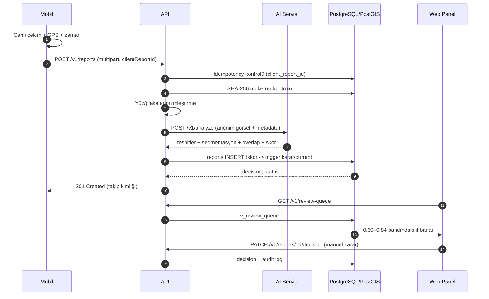

# Sistem Mimarisi

> Bu doküman, TÜBİTAK 2209-A projesinin teknik tasarım kararlarını ve bileşenler arası sözleşmeleri tanımlar. Faz 0 itibarıyla altyapı ve şema sabittir; iş mantığı fazlar halinde eklenecektir.

## 1. Bağlam ve Aktörler

| Aktör | Etkileşim |
| --- | --- |
| Vatandaş | Mobil uygulama ile canlı fotoğraf + GPS + zaman gönderir |
| Moderatör | Web panelde 0.60–0.84 bandındaki ihbarları inceler |
| Belediye yöneticisi | Eşikleri, kullanıcıları ve müdahale önceliklerini yönetir |
| Analist | H3 / DBSCAN / Gi* analizlerini çalıştırır, rapor alır |
| AI Servisi | Makine-makine; görsel analiz ve skor üretir |

## 2. Bileşen Sorumlulukları

### 2.1 Mobil (`apps/mobile`)

- **Yalnızca canlı kamera.** Galeri erişimi yok; kanıt bütünlüğü için.
- GPS doğruluk yarıçapı ve zaman kayması doğrulaması.
- Çevrimdışı kuyruk; `client_report_id` ile idempotent gönderim.
- Görseli yükleme öncesi yeniden boyutlandırır, EXIF'i temizler.

**Sorumlu olmadığı şeyler:** ihlal kararı, anonimleştirme, mekânsal analiz.

### 2.2 API (`services/api`)

- Kimlik doğrulama / yetkilendirme (Supabase Auth JWT doğrulaması — Faz 1).
- Şema doğrulama (zod), idempotency, hız sınırlama.
- **KVKK anonimleştirme:** yüz ve plaka tespiti -> Gauss bulanıklaştırma; orijinal görsel erişimi rol bazlı.
- **Mükerrer kontrol:** SHA-256 görsel hash'i + konum/zaman yakınlığı (Haversine + zaman penceresi).
- **Karar yönlendirme:** AI skorunu `system_setting.decision.thresholds` ile sınıflandırma, durum güncelleme, audit log.
- Görsel depolama soyutlaması (`local` / `supabase`).
- AI servisine HTTP istemcisi (timeout + retry + devre kesici).

**Sorumlu olmadığı şeyler:** model çıkarımı, H3 hücresi hesaplama (h3-pg varsa DB yapar), harita görselleştirme.

### 2.3 AI Servisi (`services/ai-service`)

- ONNX Runtime oturumları: detektör (YOLO26 / RF-DETR) + segmenter.
- Görüntü ön işleme, batch'leme, warm-up.
- Tespit kutuları + sınıf + güven; kaldırım/yaya geçidi maskesi.
- **Overlap:** `|engel_maskesi ∩ yürünebilir_alan| / |engel_maskesi|`.
- Skor füzyonu ve kalibrasyon; sonucu API'ye döner (DB'ye yazmaz).
- Model sürümü ve gecikme raporlar.

**Sorumlu olmadığı şeyler:** kullanıcı verisi kalıcılığı, kararın nihai kaydı (API yazar).

### 2.4 Veritabanı (`infra`)

- PostgreSQL 16 + PostGIS 3.4 + h3-pg.
- `reports.location` üzerinde GiST indeksi; H3 hücresi trigger ile.
- Karar fonksiyonu ve trigger'ları (skor -> karar -> durum).
- `mv_h3_density` ve `v_review_queue` görünümleri.
- Denetim izi (`report_audit_log`).

### 2.5 Web Paneli (`apps/web`)

- Salt-okunur ağırlıklı okuma + moderasyon yazmaları (yalnızca API üzerinden).
- MapLibre katmanları: nokta, H3 choropleth, Gi* sıcak/soğuk nokta, DBSCAN kümeleri.
- Rol bazlı görünürlük: orijinal görsel yalnızca yetkili rollere.

### 2.6 ML Pipeline (`ml-pipeline`)

- Etiket formatı dönüşümleri (YOLO / COCO / maske).
- Eğitim, değerlendirme, kalibrasyon, ONNX export.
- Model registry adlandırması ve metrik raporu.

## 3. Uçtan Uca Veri Akışı



### Karar noktaları

| Aşama | Kural | Sonuç |
| --- | --- | --- |
| Idempotency | `client_report_id` mevcut | 200 + mevcut kayıt (yeni kayıt yok) |
| Mükerrer görsel | Aynı `sha256` + yakın konum/zaman | `duplicate_of` işaretlenir, kuyruğa düşük öncelik |
| Zaman doğrulama | `captured_at` > now + 5 dk | 422 (saat manipülasyonu) |
| Konum doğrulama | GPS doğruluğu > 50 m | 422 veya `gps_source=manual` uyarısı |
| Skor | `>= 0.85` / `0.60–0.84` / `< 0.60` | kabul / inceleme / ret |

## 4. Karar Motoru ve Eşik Yönetimi

- Tek doğruluk kaynağı: `system_setting.decision.thresholds` (JSONB).
- DB tarafında `decision_for_score()` ve `apply_report_decision` trigger'ı.
- API ve AI servisi aynı varsayılanları `.env` üzerinden taşır; **Faz 3'te** açılışta DB'den okuyacak şekilde bağlanacak.
- Manuel kararlar (`manual_accept` / `manual_reject`) skor güncellemelerinde korunur.
- Eşik değişikliği audit log'a yazılır (Faz 4 paneli).

**Neden 0.85 / 0.60?** Başlangıç değerleri; Faz 2 sonunda doğrulama seti üzerinde precision/recall dengesine göre kalibre edilecek. Otomatik kabulün yanlış pozitif maliyeti yüksek olduğu için muhafazakâr başlanır.

## 5. Mekânsal Analiz Tasarımı

### 5.1 H3 Izgarası

| Çözünürlük | Ortalama alan | Kullanım |
| --- | --- | --- |
| 7 | ~5.16 km² | İlçe / makro planlama |
| 8 | ~0.74 km² | Mahalle |
| **9 (varsayılan)** | **~0.105 km²** | Sokak grubu / operasyon |
| 10 | ~0.015 km² | Kesin müdahale noktası |

- Hücre hesaplama: h3-pg varsa DB trigger'ı, yoksa uygulama katmanı.
- `mv_h3_density` hücre + tür bazında yoğunluk, ortalama güven, ilk/son görülme ve centroid üretir.
- Yenileme: `REFRESH MATERIALIZED VIEW CONCURRENTLY mv_h3_density`.

### 5.2 Sıcak Nokta Yöntemleri

| Yöntem | Girdi | Çıktı | Not |
| --- | --- | --- | --- |
| DBSCAN | Nokta koordinatları, `eps` (m), `min_samples` | Küme etiketi, gürültü | Yoğunluk tabanlı, küme şekli serbest |
| Getis-Ord Gi* | H3 hücre sayımları + komşuluk | z-skoru, p-değeri, sıcak/soğuk | İstatistiksel anlamlılık |

- DBSCAN: `eps ≈ 120 m`, `min_samples ≈ 5` başlangıç; veri hacmiyle kalibre edilir.
- Gi*: H3 k-ring komşuluğu (k=1 veya 2), queen contiguity yerine H3 komşuluğu kullanılır.
- Sonuçlar `hotspot_analyses` + `hotspot_cells` tablolarına yazılır; panel aynı anda birden fazla analizi karşılaştırabilir.

### 5.3 Öneri Skoru (müdahale önceliği)

```text
priority = w1 * normalized_density
         + w2 * severity
         + w3 * recency
         + w4 * repeat_offender_flag
```

Ağırlıklar `system_setting` içinde tutulacak (Faz 5).

## 6. API Sözleşmesi (hedef)

| Metot | Yol | Açıklama | Faz |
| --- | --- | --- | --- |
| `POST` | `/v1/reports` | Multipart ihbar oluşturma | 1 |
| `GET` | `/v1/reports/:id` | İhbar detayı (rol bazlı) | 1 |
| `GET` | `/v1/reports` | Filtreli liste | 1 |
| `GET` | `/v1/review-queue` | Manuel inceleme kuyruğu | 3 |
| `PATCH` | `/v1/reports/:id/decision` | Manuel karar | 3 |
| `GET` | `/v1/stats/summary` | Panel KPI'ları | 4 |
| `GET` | `/v1/h3/density` | H3 yoğunluk (bbox, tür, çözünürlük) | 5 |
| `POST` | `/v1/hotspots/analyze` | DBSCAN / Gi* çalıştır | 5 |
| `GET` | `/v1/hotspots/:id` | Analiz sonucu | 5 |
| `GET` | `/health`, `/health/ready` | Sağlık | 0 ✅ |

### Hata Sözleşmesi (RFC 7807 uyumlu)

```json
{
  "type": "https://api.yaya.local/errors/validation",
  "title": "Doğrulama hatası",
  "status": 422,
  "detail": "capturedAt gelecekte olamaz",
  "instance": "/v1/reports",
  "errors": [{ "path": "capturedAt", "message": "gelecekte olamaz" }]
}
```

## 7. Güvenlik ve KVKK

### 7.1 Veri sınıflandırması

| Veri | Sınıf | Saklama | Erişim |
| --- | --- | --- | --- |
| Orijinal görsel (yüz/plaka) | Kişisel veri | 2 yıl (varsayılan) | `moderator`, `municipality_admin` |
| Anonimleştirilmiş görsel | Kişisel veri değil | 2 yıl | Tüm personel |
| Tespit kutuları, overlap, skor | Türetilmiş / anonim | Süresiz (istatistik) | Analist + panel |
| GPS koordinatı | Kişisel veri (konum) | 2 yıl | Rol bazlı; agregasyonda H3 |
| E-posta / kimlik | Kişisel veri | Hesap ömrü | Yönetici |

### 7.2 Kontroller

- TLS zorunlu; JWT tabanlı kimlik doğrulama; rol bazlı erişim (RBAC).
- Yükleme sınırı (boyut, MIME, çözünürlük) ve görsel yeniden kodlama (polyglot riskine karşı).
- Hız sınırlama: kullanıcı başına dakikada N ihbar, IP başına saatlik kota.
- SQL enjeksiyonuna karşı parametreli sorgular; `pg` / Prisma.
- Sırlar yalnızca ortam değişkeni / secret manager üzerinden.
- Audit log değiştirilemez (yalnızca INSERT; UPDATE/DELETE için ayrı rol kısıtı — Faz 3).
- Log'larda kişisel veri maskelenir; görsel içerik loglanmaz.

### 7.3 Saklama ve imha

- `reports.retention_expires_at` süresi dolan kayıtlar için zamanlanmış temizlik işi (Faz 3).
- Görseller silinir; `reports` satırı istatistiksel amaçla anonim tutulur (konum H3'e indirgenebilir).
- Silme işlemleri audit log'a yazılır.

## 8. Hata Toleransı ve Gözlemlenebilirlik

| Konu | Yaklaşım |
| --- | --- |
| AI servisi erişilemez | İhbar `queued` kalır; kuyruk işçisi yeniden dener (Faz 3) |
| AI timeout | 30 s üstü istek `failed` + manuel inceleme bandına düşer |
| Görsel yükleme hatası | Mobilde üstel geri çekilme; idempotent yeniden gönderim |
| DB bağlantı havuzu | `pg` pool, maksimum bağlantı sınırı, health-check |
| Loglama | JSON yapılandırılmış log (pino / structlog), korelasyon kimliği |
| Metrikler | İstek süresi, AI gecikmesi, karar dağılımı, kuyruk yaşı (Faz 6) |

## 9. Dağıtım Topolojisi

```text
[Expo/EAS]  [Next.js/Vercel veya Node]      [Yönetilen PostgreSQL + PostGIS]
     \               |                              |
      \--> [API (konteyner)] --HTTP--> [AI (GPU/CPU konteyner)]
                    |
             [Nesne depolama: S3 / Supabase Storage]
```

- Geliştirme: `docker compose` (yerel PostGIS + servisler).
- Üretim: API ve AI ayrı konteynerler; veritabanı yönetilen servis; görseller nesne depolamada.
- AI servisi GPU'lu düğümde çalışabilir; ONNX Runtime CPU'da da çalışır (gecikme hedefi: < 2 s / görsel, CPU).

## 10. Açık Riskler ve Kararlar

| Risk | Etki | Planlanan önlem |
| --- | --- | --- |
| h3-pg'nin yönetilen DB'de olmaması | H3 trigger çalışmaz | Uygulama katmanında `h3-js` / `h3` ile hesaplama |
| YOLO26 ağırlıklarının lisansı | Ticari kullanım kısıtı | RF-DETR alternatifi + lisans incelemesi |
| Segmentasyon maskesi kalitesi | Overlap hatası | mIoU eşiği; düşük kalitede manuel inceleme |
| GPS spoofing | Konum güvenilirliği | Doğruluk eşiği, saat kayması, EXIF çapraz kontrol |
| KVKK ihlali | Hukuki risk | Anonimleştirme + saklama süresi + RBAC + audit |
| Model drift | Yanlış kararlar | Sürüm takibi, periyodik doğrulama seti, eşik gözden geçirme |

## 11. ADR Özeti (karar günlüğü)

| # | Karar | Gerekçe |
| --- | --- | --- |
| 1 | Monorepo (npm workspaces) | Tek sürüm izi, paylaşılan tipler, tek CI |
| 2 | Fastify (Express yerine) | Performans, şema tabanlı doğrulama, TypeScript desteği |
| 3 | Karar eşiğinin DB'de tutulması | Operasyonel ayar; kod dağıtımı gerektirmez |
| 4 | H3 (Grid/geohash yerine) | Düzgün altıgen komşuluk, Gi* için uygun, çok ölçekli |
| 5 | ONNX Runtime | Framework bağımsız, CPU/GPU, düşük gecikme |
| 6 | AI'ye anonim görsel gönderilmesi | KVKK minimizasyonu; modelin yüze ihtiyacı yok |
| 7 | PostGIS `geometry(Point,4326)` | Standart, indekslenebilir, Supabase uyumlu |
| 8 | `bigint` H3 hücresi | h3-pg v4 uyumu; string'e göre daha verimli indeks |
